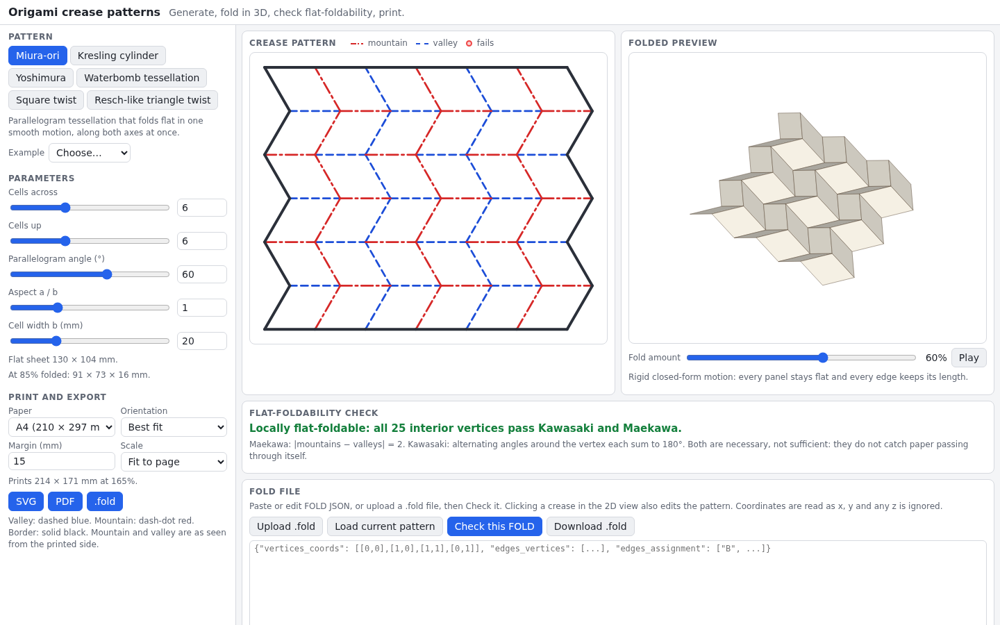

# Origami Crease Patterns

Generate origami crease patterns, fold them in 3D, and check that they can really fold flat. Pick Miura-ori, Kresling, Yoshimura, waterbomb tessellation, square twist or a Resch-style triangle twist, tune the parameters, and get a crease pattern with mountain folds in red and valley folds in blue. A flat-foldability checker tests Maekawa's and Kawasaki's theorems at every interior vertex and circles the ones that fail. Upload or edit a `.fold` file to check your own design, and print a template on A4 or Letter as SVG or PDF.

**Try it: [hermes98761234.github.io/origami-crease-patterns](https://hermes98761234.github.io/origami-crease-patterns/)**

[](https://github.com/hermes98761234/origami-crease-patterns/actions/workflows/deploy.yml)



## Features

- **Six pattern generators** with parameters: Miura-ori (cells, angle, aspect), Kresling (sides, stories, height, twist), Yoshimura, waterbomb tessellation, square twist and triangle twist. Each has example presets.
- **3D folded preview with a fold-amount slider.** Miura-ori uses an exact rigid closed-form motion. Kresling uses closed-form positions, shows the bistable second state when there is one, and reports how much the panels flex. Yoshimura and waterbomb use a small spring simulation and say so. Twists fold flat in layers, so they have no 3D preview.
- **Flat-foldability check.** Maekawa (|M − V| = 2) and Kawasaki (alternating angles sum to 180°) at every interior vertex, with a table of the failing vertices that you can click to locate.
- **Bring your own pattern.** Upload or paste FOLD JSON, or click a crease in the 2D view to cycle mountain, valley, flat and unassigned, and watch the check update.
- **Print-ready export.** SVG and PDF at A4 or Letter, with margins, fit-to-page or 1:1 millimetres, and the print convention: valley dashed, mountain dash-dot, border solid. `.fold` export too.
- Light and dark themes, works on a phone, inputs remembered in the browser, nothing uploaded anywhere.

## How it works

**Flat-foldability.** At an interior vertex, sort the creases by angle and take the sector angles between neighbours. Kawasaki's theorem needs the alternating sums of those sectors to both equal 180°. Maekawa's theorem needs the numbers of mountain and valley creases to differ by exactly 2. Both are necessary for a flat fold and sufficient for a single vertex; they do not prove that the whole sheet folds without passing through itself (Bern and Hayes showed that is NP-hard in general).

**Miura-ori.** With parallelogram sides b and a and angle α, fold angle φ runs from 0 (flat) to α (flat-folded). The folded vertices are
`x = i·b·cos φ + (j odd ? a·cos α / cos φ : 0)`, `y = j·a·√(1 − cos²α / cos²φ)`, `z = (i odd ? b·sin φ : 0)`.
Every face stays a planar parallelogram with its flat side lengths, so the motion is rigid, and both width and length shrink together (a negative Poisson ratio). Tests check this for every edge at many fold amounts.

**Kresling.** Rings of an n-gon (radius R) are stacked and twisted by ψ. With story height h the vertical creases have length m² = h² + 4R² sin²(ψ/2) and the diagonals d² = h² + 4R² sin²(π/n − ψ/2). Holding m and d fixed gives m² − d² = 4R² sin(π/n) sin(ψ − π/n), so a second solution ψ′ = π + 2π/n − ψ exists whenever its height is real. That is the bistable state. Between the two states the sheet is not rigid, and the app reports the peak diagonal strain.

**Yoshimura and waterbomb.** Both are triangular lattices with six creases per vertex and sector angles A, B, A, A, B, A with 2A + B = 180°, so Kawasaki holds for any proportions.

**Twist folds.** A regular n-gon sits in the middle of the sheet. Two creases leave each corner, at angles τ ± π/n from the outward direction, so the sectors at the corner are (π − 2π/n), π/2 − τ, 2π/n, π/2 + τ and both alternating sums are 180°. Neighbouring rays are parallel, which leaves a pleated band along every side.

References: Miura, *Method of packaging and deployment of large membranes in space* (1985); Kresling, *Origami-structures in nature* (2008); Hull, *Project Origami* (2012); Demaine and O'Rourke, *Geometric Folding Algorithms* (2007); FOLD format by Demaine, Ku and Lang, [github.com/edemaine/fold](https://github.com/edemaine/fold).

## Quick start

You need [Node.js](https://nodejs.org/) 22.

```bash
git clone https://github.com/hermes98761234/origami-crease-patterns.git
cd origami-crease-patterns
npm install
npm run dev       # http://localhost:5173
npm test          # checker, kinematics, FOLD round trip, export
npm run build     # static site in dist/
```

## License

MIT.
